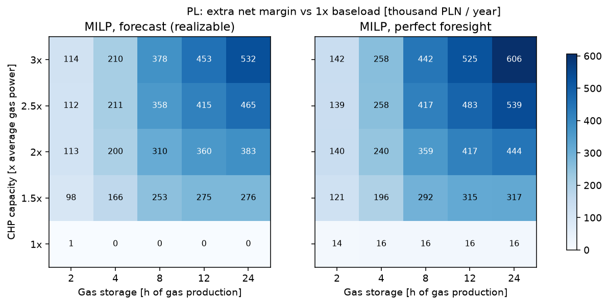
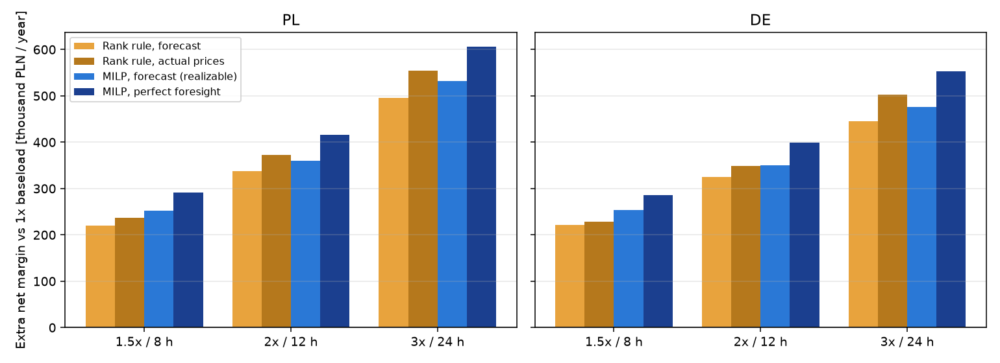
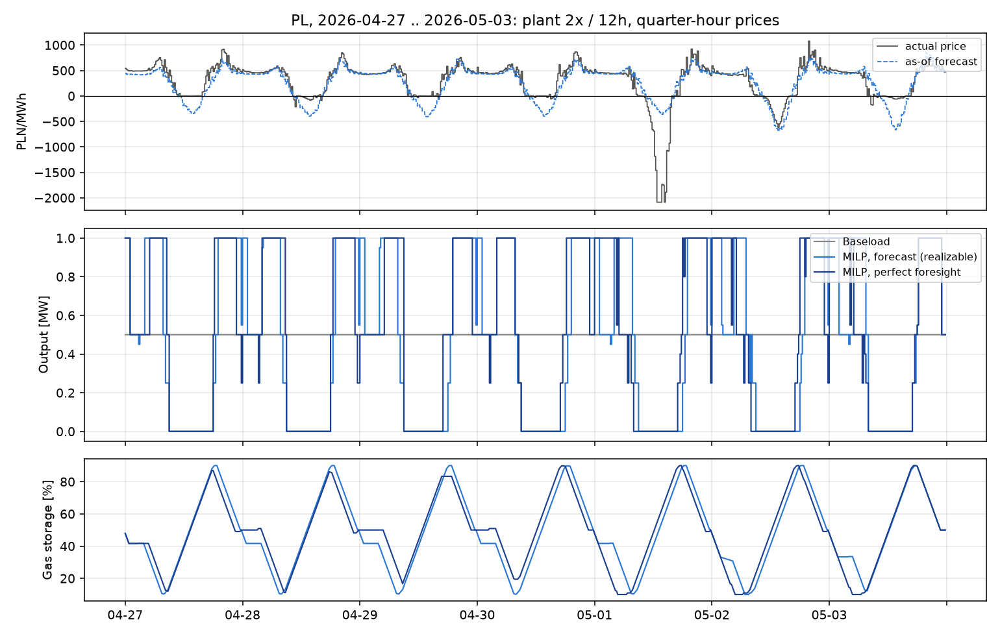
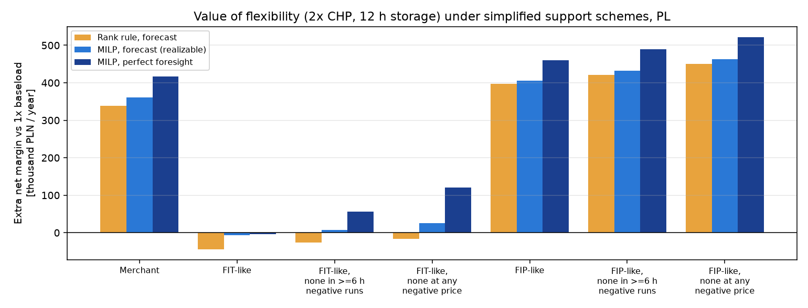
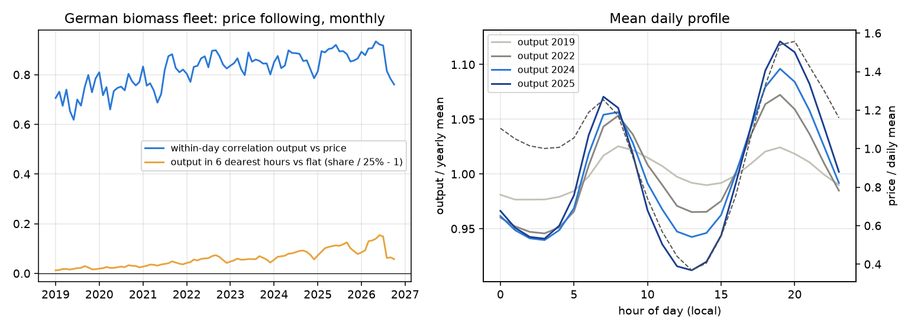

# pl-biogas-flex

[](https://github.com/kwwaleszczynski-del/pl-biogas-flex/actions/workflows/ci.yml)
[](https://kwwaleszczynski-del.github.io/pl-biogas-flex/)

How much is flexible operation of an agricultural biogas CHP plant worth on Polish day-ahead prices, compared with
running it flat out all day? And how much extra engine capacity and gas storage does it take to earn it?

An agricultural biogas plant makes gas at a roughly constant rate. Almost all of the ~200 Polish agricultural
biogas plants are CHP units (203 of 209 installations in the KOWR register on 28.05.2026), and a typical one burns
the gas as it comes, in an engine running around 8,000 hours a year. With more engine capacity than the gas supply
needs, a gas storage and a heat tank, the same gas can be burnt in the expensive hours and kept back in the cheap
and negative ones. This repository backtests that day by day on Polish prices from January 2024 to October 2026, with a plant
model solved as a mixed-integer program, an honest forecast-based strategy that only uses information available
before the day-ahead gate closure, a design grid of engine capacity and storage, simple support-scheme scenarios and
Germany as a reference market where biogas plants have been paid to be flexible since 2012 (EEG flexibility
premium).

**Dashboard:** <https://kwwaleszczynski-del.github.io/pl-biogas-flex/> (sliders for engine capacity and storage
hours, revenue breakdown per strategy, example week of dispatch, German fleet).

## Key results

Whole period 1.1.2024-25.10.2026, annualised, merchant (day-ahead prices only), generic plant with 1.25 MW of gas,
illustrative costs. "Extra" is net margin above today's plant: one 500 kW engine at full load all year, which earns
1.48 M PLN/yr in Poland (capture price 454 PLN/MWh) and 1.24 M PLN/yr at German prices.

- **Flexibility is worth a lot on Polish prices.** Doubling the engine capacity with 12 h of gas storage adds
  **+360 k PLN/yr with the realizable strategy** (+24% of today's margin) and +417 k PLN/yr with perfect foresight.
  The plant sells the same gas at 563 instead of 454 PLN/MWh and cuts exports at negative prices from 131 to 9 MWh a
  year, at the cost of ~1,140 engine starts a year.
- **Storage decides, not engines alone.** With the 2 h of storage most plants already have, extra engines are worth
  only ~100-115 k PLN/yr whatever their size. The value climbs with storage up to ~12 h; beyond that only the 2.5x
  and 3x plants still gain (3x / 24 h: +532 k PLN/yr realizable, +606 k with perfect foresight).
- **The honest strategy keeps 80-88% of the perfect-foresight value.** It plans each day before gate closure on a
  seven-day mean price profile. The simple price-rank rule on the same forecast does almost as well with 8-24 h of
  storage (94% of the MILP at 2x / 12 h) but collapses with small storage (46% at 2x / 4 h), where the storage
  limits make the dearest hours infeasible.
- **The value is rising.** For 2x / 12 h: +272 k PLN in 2024, +329 k in 2025 and +507 k PLN/yr in 2026 so far, as
  negative hours (189, 311 and 303 hours) and the daily spread between the six dearest and six cheapest hours
  (346, 393 and 536 PLN/MWh) grow.
- **Payback at the assumed costs:** 7.2 years for the cheapest step (1.5x with 8 h of storage), 9.7 years for
  2x / 12 h (6.6 years on 2026 prices), about 14 years for 3x with 12-24 h. Extra engines without more storage
  (2 h) take 17 to over 100 years.
- **Polish prices now reward flexibility as much as German ones.** The same plant on German prices earns a similar
  extra (2x / 12 h: +350 k PLN/yr realizable) on a lower base. German biomass plants have been paid to be flexible
  since 2012, and it shows: the daily swing of the whole fleet's output grew from 6.6% (2019) to 27.6% (2026) and output in
  negative-price hours fell from 98% to 87% of the daily mean.
- **Support schemes decide whether flexibility pays at all** (stylised, to verify): a fixed price per MWh (FIT-like)
  removes the incentive completely (2x / 12 h: -7 k PLN/yr realizable); withholding it in negative-price runs brings
  back only a little (+8 k for the 6-hour rule, +26 k if every negative interval counts). A sliding premium on the
  monthly mean price (FIP-like) keeps the full market incentive (+406 k), and taking the premium away in negative
  hours raises the value of flexibility further (+432 k / +463 k).

### Design grid, Poland

Extra net margin of the realizable strategy (MILP on the as-of forecast) over today's plant, thousand PLN per year:

| CHP capacity \ gas storage | 2 h | 4 h | 8 h | 12 h | 24 h |
|---|---:|---:|---:|---:|---:|
| 1x (500 kW) | 1 | 0 | 0 | 0 | 0 |
| 1.5x | 98 | 166 | 253 | 275 | 276 |
| 2x | 113 | 200 | 310 | 360 | 383 |
| 2.5x | 112 | 211 | 358 | 415 | 465 |
| 3x | 114 | 210 | 378 | 453 | 532 |

Simple payback of the realizable strategy (years, capex and fixed opex as in the assumptions table):

| CHP capacity \ gas storage | 2 h | 4 h | 8 h | 12 h | 24 h |
|---|---:|---:|---:|---:|---:|
| 1.5x | 17.3 | 10.0 | **7.2** | 7.4 | 10.2 |
| 2x | 34.2 | 16.6 | 10.7 | 9.7 | 11.1 |
| 2.5x | 68.1 | 25.3 | 13.7 | 12.2 | 12.4 |
| 3x | 126.9 | 38.0 | 17.6 | 14.7 | 13.8 |



### Strategies for three designs

Extra net margin over today's plant, thousand PLN per year:

| Market | Design | Rank rule, forecast | Rank rule, actual prices | MILP, forecast (realizable) | MILP, perfect foresight | Investment | Payback (realizable) |
|---|---|---:|---:|---:|---:|---:|---:|
| PL | 1.5x / 8 h | 220 | 238 | 253 | 292 | 1.64 M PLN | 7.2 y |
| PL | 2x / 12 h | 338 | 372 | 360 | 417 | 3.05 M PLN | 9.7 y |
| PL | 3x / 24 h | 496 | 554 | 532 | 606 | 6.07 M PLN | 13.8 y |
| DE | 1.5x / 8 h | 221 | 228 | 254 | 286 | 1.64 M PLN | 7.2 y |
| DE | 2x / 12 h | 324 | 349 | 350 | 399 | 3.05 M PLN | 10.0 y |
| DE | 3x / 24 h | 445 | 503 | 476 | 552 | 6.07 M PLN | 15.8 y |



The rank rule on actual prices sometimes beats the realizable MILP: knowing the prices matters more than optimising
on a forecast. The gap between perfect foresight and the realizable MILP (57 k PLN/yr at 2x / 12 h in Poland) is the
value of a better price forecast or of price-limited bids.

### By year, 2x / 12 h

| Period | Today's plant, k PLN/yr | Capture price today, PLN/MWh | Realizable extra | Perfect-foresight extra | Rank rule extra | Payback (realizable) |
|---|---:|---:|---:|---:|---:|---:|
| PL 2024 | 1,322 | 415 | 272 | 322 | 250 | 13.5 y |
| PL 2025 | 1,432 | 442 | 329 | 383 | 307 | 10.8 y |
| PL 2026 (to 25.10) | 1,735 | 517 | 507 | 575 | 485 | 6.6 y |
| PL last 12 months | 1,729 | 516 | 452 | 519 | 435 | 7.5 y |
| DE 2024 | 1,013 | 338 | 262 | 311 | 240 | 14.1 y |
| DE 2025 | 1,175 | 378 | 323 | 371 | 296 | 11.0 y |
| DE 2026 (to 25.10) | 1,581 | 479 | 492 | 541 | 463 | 6.8 y |

### An example week

The week with the most negative Polish quarter-hours since quarter-hour products started (27.04-03.05.2026, with
about -2,100 PLN/MWh around noon on 1 May): the flexible plant stops at midday, fills the gas storage and runs both
engines in the morning and evening peaks. The realizable plan follows the forecast and misses some of the price
spikes that perfect foresight catches.



### Support schemes

Extra net margin over today's plant under the same scheme, thousand PLN per year, Poland, whole period (stylised
schemes, see "Support-scheme scenarios" below; 3x = 1.5 MW, above the 1 MW limit of the Polish FIT/FIP):

| Scheme | Today's plant, net | 2x / 12 h rank rule | 2x / 12 h realizable | 2x / 12 h perfect foresight | 3x / 24 h realizable | 3x / 24 h perfect foresight |
|---|---:|---:|---:|---:|---:|---:|
| Merchant | 1,481 | 338 | 360 | 417 | 532 | 606 |
| FIT-like (fixed 894 PLN/MWh) | 3,254 | -44 | -7 | -4 | -2 | 3 |
| FIT-like, none in >= 6 h negative runs | 3,193 | -26 | 8 | 56 | 27 | 64 |
| FIT-like, none at any negative price | 3,127 | -16 | 26 | 121 | 55 | 130 |
| FIP-like (premium on monthly mean) | 3,254 | 398 | 406 | 461 | 612 | 687 |
| FIP-like, none in >= 6 h negative runs | 3,225 | 422 | 432 | 489 | 639 | 716 |
| FIP-like, none at any negative price | 3,193 | 451 | 463 | 521 | 670 | 749 |

Under the FIP-like scheme flexibility is worth more than on the market alone, for a metering reason: while the
engines stand still the plant buys its own consumption from the grid instead of netting it, so ~130 MWh a year more
of its output counts as exported and earns the premium. The negative-price rules cost today's flat plant 29-127 k
PLN a year of support (61 k under the PL-like 6-hour rule with a fixed price).



### Germany: the biomass fleet already follows prices

| Year | Daily swing (max-min)/mean | Within-day correlation with price | Output in 6 dearest hours | Output in negative hours / daily mean | Negative-price hours |
|---|---:|---:|---:|---:|---:|
| 2019 | 6.6% | 0.71 | 25.5% | 98% | 211 |
| 2021 | 10.2% | 0.79 | 25.9% | 98% | 139 |
| 2023 | 14.1% | 0.84 | 26.4% | 96% | 301 |
| 2024 | 19.0% | 0.86 | 26.9% | 93% | 457 |
| 2025 | 25.2% | 0.88 | 27.5% | 89% | 573 |
| 2026 (to 25.10) | 27.6% | 0.87 | 27.7% | 87% | 462 |

The German fleet (about 4 GW of biomass output, all technologies) has moved from a flat line to a clear double peak
that mirrors the price profile, and produces less and less into negative prices. A flat fleet would put 25% of its
output into the six dearest hours; the fleet as a whole is at 27.7%, because many plants are still inflexible and
solid-biomass plants run flat. The within-day correlation is already high in 2019 because the small shifts then
already followed the daily price shape. The last three months of 2026 show a weaker swing; recent SMARD values may
still be revised.



### Solver checks

- Two-stage quarter-hour plan against the joint quarter-hour MILP on 12 sample days (`results/two_stage_check.csv`):
  -0.02% to +0.07% of the objective for four designs, worst single day 0.24% (the joint MILP also stops at 0.5%).
- MILP relative gaps: at most 0.5% by construction, mean 0.06%.

## Data

| Source | Content | Licence / terms |
|---|---|---|
| [PSE S.A.](https://api.raporty.pse.pl), report `csdac-pln` via [pse-opendata](https://github.com/kwwaleszczynski-del/pse-opendata) | Day-ahead (SDAC) price of the Polish bidding zone, 14.06.2024 onwards | Public sector information, re-use conditions in the PSE BIP |
| PSE legacy export `PL_CENY_RYN_EN` | Hourly RCE before 14.06.2024 | as above |
| [SMARD.de](https://www.smard.de) (Bundesnetzagentur) | DE-LU day-ahead price (filter 4169), net generation from biomass (filter 4066) | CC BY 4.0, "Bundesnetzagentur \| SMARD.de" |
| [ECB](https://data.ecb.europa.eu) | EUR/PLN reference rate (`EXR.D.PLN.EUR.SP00.A`), to express German prices in PLN | ECB statistics, free re-use with source |

Raw downloads stay in `data/` (git-ignored); only derived results (`results/`, `docs/`) are committed.

**Quarter-hours.** Both markets moved from hourly to 15-minute day-ahead products on delivery day **1 October 2025**
(SDAC go-live; the APIs repeat the hourly price in four quarter-hours before). The code does not hard-code the date:
a day whose four quarter-hours carry the same price in every hour is optimised with one-hour intervals, any other
day with 15-minute intervals. In the data the first quarter-hour day is 2025-10-01 in both markets. The backtest
covers 1,029 delivery days (1.1.2024-25.10.2026) per market: 639 hourly and 390 quarter-hour days, including the
daylight-saving days (23/25 hours, 92/100 quarter-hours). Poland had 802 hours with a negative price in that period
(mean price 454 PLN/MWh), Germany 1,497 (mean 393 PLN/MWh at the ECB rate).

## Plant model

A generic plant sized on a 500 kWe engine: the digester delivers a constant gas flow $`G`$ = 1.25 MW (what that
engine burns at full load, 40% electrical efficiency). For each delivery day with intervals $`t`$ of length
$`\Delta t`$ (1 h or 15 min) and engines $`e`$, the MILP (HiGHS through `scipy.optimize.milp`) chooses engine output
$`P_{e,t}`$, an hourly on/off state $`u_{e,h}`$, gas storage level $`S_t`$, boiler heat $`B_t`$, heat tank level
$`T_t`$, export $`E_t`$ and import $`I_t`$ to maximise

```math
\sum_t \Delta t \left[ r_t E_t - (p_t + f) I_t - m \sum_e P_{e,t} \right] - c_{\mathrm{start}} \sum_{e,h} v_{e,h}
```

subject to

```math
\begin{aligned}
& P^{\min}_e u_{e,h(t)} \le P_{e,t} \le P^{\max}_e u_{e,h(t)}, \quad u_{e,h} \in \{0,1\} \\
& F_{e,t} = a_e u_{e,h(t)} + b_e P_{e,t} \\
& v_{e,h} - w_{e,h} = u_{e,h} - u_{e,h-1} \\
& S_t = S_{t-1} + \Delta t \left( G - \textstyle\sum_e F_{e,t} - B_t / \eta_B - X_t \right), \quad S^{\min} \le S_t \le S^{\max}, \quad S_{\mathrm{end}} = S_0 \\
& T_t = T_{t-1} + \Delta t \left( \eta_{\mathrm{th}} \textstyle\sum_e F_{e,t} + B_t - q_t - D_t \right), \quad 0 \le T_t \le T^{\max}, \quad T_{\mathrm{end}} = T_0, \quad B_t \le q_t \\
& \textstyle\sum_e P_{e,t} - L = E_t - I_t, \quad I_t \le L (1 - u_{e,h(t)})
\end{aligned}
```

- $`r_t`$ is what one exported MWh earns (market price, or the rate of a support scenario), $`p_t`$ the market
  price, $`f`$ the fee on electricity drawn from the grid, $`m`$ maintenance per MWh, $`c_{\mathrm{start}}`$ the cost
  of an engine start ($`v`$ starts, $`w`$ stops).
- The affine fuel curve $`F = a u + b P`$ gives part-load efficiency: 40% at full load, 36% at the 50% minimum load.
- The gas storage starts and ends every day at 50% (between 10% and 90% of its volume); the heat tank likewise. So
  every strategy burns the same daily gas: flexibility only moves production in time.
- The heat obligation $`q_t`$ (digester and a small heat customer) follows a seasonal cosine between 45% of the
  rated CHP heat in January and 15% in July. Engine heat goes to demand or the tank, the rest is dumped; a biogas
  boiler can cover demand from the gas storage while the engines stand still.
- Own consumption $`L`$ (8% of 500 kW) is covered by the engines when any runs and bought otherwise (one net meter).
- Engines are committed per clock hour (minimum up and down time 1 h). Quarter-hour days are solved in two stages:
  the MILP on hourly mean prices fixes the commitment, then a linear program with that commitment fixed sets the
  output of every quarter-hour between minimum and full load. A joint quarter-hour MILP spent 1-15 s per day in the
  solver's root node with three engines and small storage, too slow for 25 designs x 5 strategies x 2 markets;
  the two-stage plan loses 0.02-0.1% of the daily objective against it (`python -m biogas_flex check`, Results).
  MILPs stop at a 0.5% relative gap (on sample days within 0.03% of the 0.1%-gap solution, at 2-5x less time) and
  no wall-clock limit binds, so the results do not depend on machine load.
- Flaring is penalised in the objective (a safety device, not a market option); the boiler has a small penalty.
  Neither penalty is part of the reported money.

Design grid: engine capacity 1x, 1.5x, 2x, 2.5x and 3x of the 500 kW that the gas supply sustains, in one to three
engines (the existing 500 kW engine plus new ones of at most 500 kW: 1.5x = 500 + 250 kW, 3x = 3 x 500 kW), and gross
gas storage of 2, 4, 8, 12 and 24 hours of gas production (25 designs). Any design with extra engines gets a 100 m³ heat
tank (4.7 MWh at 40 K).

## Strategies

| Strategy | Information | What it does |
|---|---|---|
| Baseload | none | the original 500 kW engine at full load all day (today's plant) |
| Rank rule, forecast | as-of forecast | full output in the k most expensive hours of the forecast, k = gas of the day / gas use at full output; storage guard overrides |
| Rank rule, actual prices | look-ahead | the same rule on the actual day-ahead prices |
| MILP, forecast (**realizable**) | as-of forecast | the MILP on the forecast, settled at actual prices |
| MILP, perfect foresight | look-ahead | the MILP on the actual prices: upper bound of a day-by-day plan |

The as-of forecast for delivery day D is the mean price per local quarter-hour of the clock over D-7..D-1: at the
gate closure (12:00 on D-1) the prices of D-1 are known, those of D are not. A test changes all prices from D on and
checks that the forecast for D does not move. The sister project
[pl-bess-paper-trading](https://github.com/kwwaleszczynski-del/pl-bess-paper-trading) found this simple profile as
good as a gradient-boosting model for ranking the hours of a day. Every strategy is settled the same way at actual
prices.

## Support-scheme scenarios (simplified, to verify)

Polish agricultural biogas plants up to 1 MW can use a feed-in tariff (FIT, below 500 kW) or a feed-in premium
(FIP, 500 kW to 1 MW) under the RES act (ustawa o odnawialnych źródłach energii, art. 70a-70f); larger ones need an
auction. The scenarios below are **stylised simplifications, not a model of the act**, and must be checked against
the law in force before any use:

| Scenario | Export earns |
|---|---|
| Merchant | market price |
| Fixed price (FIT-like) | F = 894 PLN/MWh for every MWh |
| Sliding premium (FIP-like) | market price + max(0, F - monthly mean market price) |
| ... no support in >= 6 h negative runs | market price instead of F / no premium in runs of at least 6 consecutive hours with a negative hourly price (PL-like rule) |
| ... no support at any negative price | the same in every negative interval (stricter, as in newer EU and German rules) |

F = 894 PLN/MWh is about 95% of the 2023 reference price of 941 PLN/MWh for agricultural biogas in high-efficiency
cogeneration, 500 kW to 1 MW (Rozporządzenie Ministra Klimatu i Środowiska z 8 listopada 2023 r. w sprawie ceny
referencyjnej ..., Dz.U. 2023 poz. 2440; [PDF at URE](https://www.ure.gov.pl/download/9/14133/2440.pdf), checked
27.10.2026). The 95% share, the monthly-mean premium and the per-day evaluation of negative runs are simplifications.
**High-efficiency cogeneration is assumed, not checked (to be verified).** The modelled plant uses only its stylised
heat obligation, on average 30% of the rated CHP heat, and dumps the rest: 3,405 MWh of heat a year in the baseload
case (`dump_mwh` in `results/summary_PL.csv`), about 70% of the engine heat. High-efficiency cogeneration is
defined by the primary energy savings of the useful heat and power, and only the electricity that goes with useful
heat counts as cogenerated; with this much dumped heat the plant may not qualify, or only part of its output may.
Without it the same regulation lists 793 PLN/MWh for 500 kW to 1 MW, and the FIT/FIP results below would be lower.
Eligibility and the share of qualifying electricity have to be checked against the law and the plant's real heat
use before any use.
The 6-hour rule follows the RES act as described by the settlement agent and the regulator: support is withheld for
energy produced while the day-ahead price is negative for at least six consecutive hours (art. 93 of the RES act,
[ZRSA FAQ](https://www.zrsa.pl/oze/faq/), [URE on negative prices](https://www.ure.gov.pl/pl/oze/swiadectwa-pochodzenia/ceny-ujemne/12735,OZE-Prezes-Urzedu-Regulacji-Energetyki-przypomina-o-koniecznosci-skorygowania-wn.html),
both checked 27.10.2026; the act was amended again in December 2024, Dz.U. 2024 poz. 1847). Under any of these
schemes, oversizing a 500 kW plant beyond 1 MW (the 2.5x and 3x designs) may end eligibility for FIT/FIP. Context:
the KOWR register of agricultural biogas producers listed 209 installations of 175 entities, about 188.8 MWe plus
about 5.5 MW of biomethane capacity, on 28.05.2026 ([gramwzielone.pl](https://www.gramwzielone.pl/?p=20363184));
the biogas special act is Dz.U. 2023 poz. 1597 (consolidated text Dz.U. 2026 poz. 52). Nothing here is legal or
investment advice.

## Assumptions

| Parameter | Value | Source / note |
|---|---|---|
| Gas inflow | 1.25 MW (500 kWe at full load), constant | assumption; no seasonal gas yield, 100% availability |
| Electrical efficiency | 40% full load, 36% at 50% load | full load: DBFZ 2018, 400 kW example plant 40.1%; part load: assumption (typical 3-5 points lower at half load) |
| Thermal efficiency | 44% of fuel | DBFZ 2018 example plant 44.6% |
| Minimum load, min up/down | 50%, 1 h / 1 h | assumption for modern gas engines |
| Engine start | 50 PLN per start | assumption (wear and warm-up gas; DBFZ 2018 puts the extra gas from cycling at 0.04-0.26%) |
| Maintenance | 80 PLN/MWh | assumption (~1.9 ct/kWh, typical full-service contracts for 0.5 MW engines) |
| Own consumption | 8% of 500 kW, constant | assumption (typical 6-10% for agricultural plants) |
| Grid fee on purchases | 350 PLN/MWh above the market price | assumption (distribution and other charges) |
| Heat demand | 45% (January) to 15% (July) of rated CHP heat | assumption; the DBFZ example plant uses ~35% of its heat |
| Gas storage | 10-90% usable, 50% at midnight | assumption |
| Extra engine capacity | 4,000 PLN/kW installed | assumption; order of magnitude of DBFZ 2018 annuities for +400 kW (46-73 k EUR/yr) |
| Extra gas storage | 200 PLN/m³ above 2 h existing, 5.5 kWh/m³ | assumption; DBFZ 2018: 14-21 k EUR/yr for +2,800-8,350 m³ |
| Heat tank | 100 m³ at 1,200 PLN/m³ | assumption; DBFZ 2018: 5 k EUR/yr for 230 m³ |
| Grid connection upgrade | 400 PLN/kW of extra capacity | placeholder: site specific, often the real bottleneck (DBFZ leaves it out for the same reason) |
| Planning, controls | +10% of the above | assumption |
| Fixed opex of new equipment | 1.5% of capex per year | assumption |
| Support level F | 894 PLN/MWh | see support scenarios |
| EUR/PLN for Germany | ECB reference rate of the delivery day | ECB |

DBFZ 2018: M. Dotzauer, P. Kornatz, *Steckbrief Flexibilisierungskonzepte für das Anlagenbeispiel 5 (Biogasanlage,
400 kW)*, Deutsches Biomasseforschungszentrum, 14.06.2018
([PDF](https://www.unendlich-viel-energie.de/media/file/2351.DBFZ_Bewertung_von_Flexibilisierungskonzepten_Steckbrief_5_jun18.pdf)).
Costs there are annuities; the values above are rounded investment assumptions of the same order, not taken from it.
All cost numbers are illustrative and change payback times one to one; the extra margins do not depend on them.

## Limitations

- **Day by day.** The gas storage and the heat tank return to 50% at every midnight, so nothing is shifted from a
  cheap weekend to Monday. This understates the value of large storage (12-24 h) and keeps every strategy on the
  same daily gas budget.
- **Constant gas.** No seasonal gas yield, no flexible feeding of the digester, no outages or maintenance stops
  (100% availability, the real plants run ~8,000-8,250 h a year).
- **Day-ahead only.** No intraday trading, balancing energy or reserves (aFRR, mFRR), no imbalance cost: the
  realizable schedule is assumed to be delivered exactly. A real plant would also bid price limits instead of fixed
  volumes, which would close part of the gap to perfect foresight in negative hours.
- **Price taker.** One small plant does not move prices. The ~190 MWe Polish fleet would not either, but the
  German fleet (several GW) is large enough to matter there.
- **Simple forecast.** A seven-day mean profile; a better forecast narrows the gap to perfect foresight (the sister
  project measured ~83% for a battery with either this profile or a gradient-boosting model).
- **Solver.** Engines are committed per clock hour; on quarter-hour days the commitment comes from the hourly
  problem and the quarter-hour output from a linear program (loss against the joint quarter-hour MILP measured on
  sample days, see Results). MILPs stop at a 0.5% relative gap.
- **Heat** is a stylised seasonal obligation with no heat revenue; the boiler may burn biogas for heat while the
  engines stand still (reported as boiler MWh). The heat tank size is fixed (100 m³).
- **Economics** are illustrative: rounded capex and opex, no financing cost (simple payback), no taxes, no capacity
  market, no grid-connection study (often the binding constraint in Poland), no Polish support for flexibility (there
  is no equivalent of the German flexibility premium).
- **Support schemes** are stylised (see above) and must be verified against the law in force; plants above 1 MW may
  lose FIT/FIP eligibility.
- **Prices.** From 14.06.2024 the SDAC price of the Polish zone (`csdac-pln`); before, the hourly RCE of the legacy
  export (based on the TGE day-ahead market). German prices are converted at the ECB rate of the delivery day and the
  same Polish costs are used.
- **Germany.** SMARD "Biomasse" covers all biomass units (biogas, biomethane and solid biomass), not biogas alone.
  The Marktstammdatenregister (MaStR) was not used: its full export is several GB and the question did not need
  unit-level data.

## Reproduce

```bash
python -m venv .venv
.venv/Scripts/pip install -e ".[dev]"          # Linux/macOS: .venv/bin/pip
pytest -q                                       # offline tests
python -X utf8 -m biogas_flex grid --market PL  # ~1-2 h on 8 cores: 25 designs x 5 strategies x 1,029 days
python -X utf8 -m biogas_flex grid --market DE
python -X utf8 -m biogas_flex support           # support scenarios, 3 designs
python -X utf8 -m biogas_flex check             # two-stage plan vs joint quarter-hour MILP, sample days
python -X utf8 -m biogas_flex germany           # SMARD biomass fleet 2019-2026
python -X utf8 -m biogas_flex report            # tables in results/, figures in docs/img, dashboard docs/index.html
```

Layout: `src/biogas_flex/` (`milp.py` plant model, `heuristic.py` rule-based operation, `forecast.py` as-of forecast,
`support.py` scenarios, `backtest.py` settlement, `runner.py` parallel grid, `germany.py` fleet analysis,
`report.py` tables, figures and dashboard), `tests/`, `results/` (monthly sums per design and strategy, summaries),
`docs/` (GitHub Pages).

## Licence

Code: MIT. Data: PSE S.A. (public reports), Bundesnetzagentur | SMARD.de (CC BY 4.0), European Central Bank. Derived
results in `results/` and `docs/` keep these attributions.
